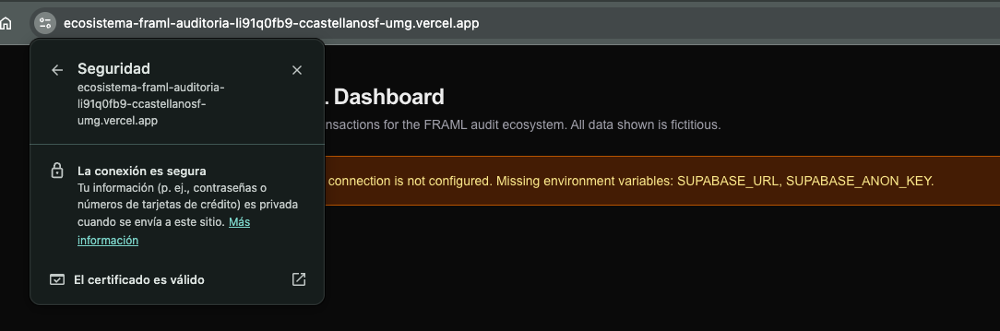
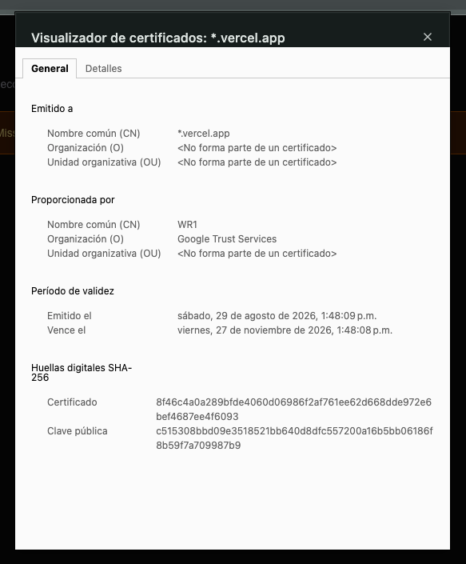

# Controles de auditoría — Desarrollador BI (Vercel)

Proyecto: Ecosistema FRAML — Fase 1
Componente: `framl-dashboard` (frontend Next.js desplegado en Vercel)
Responsable: Cristian

## 1. Protección de datos en tránsito (SSL/TLS)

**Control:** toda comunicación entre el usuario, el frontend y la base de datos viaja cifrada mediante HTTPS (TLS).

**Cómo se cumple:**

| Tramo | Mecanismo | Evidencia |
|---|---|---|
| Navegador → Vercel | Vercel emite y renueva automáticamente un certificado TLS para el dominio `*.vercel.app` y redirige HTTP a HTTPS. | Captura del candado del navegador y del detalle del certificado. |
| Navegador → Vercel | El encabezado `Strict-Transport-Security` (HSTS, 2 años) obliga al navegador a usar solo HTTPS en visitas posteriores. Definido en `next.config.ts`. | `curl -sI https://<dominio>.vercel.app` muestra el encabezado. |
| Servidor (Vercel) → Supabase | La aplicación rechaza cualquier `SUPABASE_URL` que no use `https://` (`src/lib/supabase/config.ts`, cubierto por pruebas). | `npm test` — caso "rejects non-HTTPS URLs". |

Encabezados de endurecimiento adicionales: `X-Content-Type-Options: nosniff`, `X-Frame-Options: DENY`, `Referrer-Policy` y `Permissions-Policy`. Además se oculta `X-Powered-By`.

**Evidencias a adjuntar:**

- [x] URL del despliegue: `https://ecosistema-framl-auditoria.vercel.app`
- [x] Captura del certificado TLS en el navegador (emisor, vigencia, dominio)
- [x] Salida de `curl -sI` con el encabezado `Strict-Transport-Security`
- [x] Prueba de redirección: `curl -sI http://ecosistema-framl-auditoria.vercel.app` responde `308` hacia `https://`

**Resultados verificados (2026-10-01):**

```text
$ curl -sI https://ecosistema-framl-auditoria.vercel.app
HTTP/2 200
strict-transport-security: max-age=63072000; includeSubDomains; preload
x-content-type-options: nosniff
x-frame-options: DENY
referrer-policy: strict-origin-when-cross-origin
permissions-policy: camera=(), microphone=(), geolocation=()

$ curl -sI http://ecosistema-framl-auditoria.vercel.app
HTTP/1.0 308 Permanent Redirect
Location: https://ecosistema-framl-auditoria.vercel.app/

$ openssl s_client -connect ecosistema-framl-auditoria.vercel.app:443
subject=CN=*.vercel.app
issuer=C=US, O=Google Trust Services, CN=WR1
notBefore=Aug 29 19:48:09 2026 GMT
notAfter=Nov 27 19:48:08 2026 GMT
Protocol: TLSv1.3, Cipher: TLS_AES_128_GCM_SHA256
```

El certificado es emitido por una autoridad de certificación pública (Google Trust Services) y Vercel lo renueva automáticamente antes de su vencimiento. La conexión negocia TLS 1.3.

**Capturas del navegador:**

| Conexión segura | Detalle del certificado |
|---|---|
|  |  |

## 2. Gestión de llaves

**Control:** las credenciales de la base de datos nunca se guardan en texto plano dentro del código fuente ni del repositorio.

**Cómo se cumple:**

1. **Variables de entorno en Vercel.** `SUPABASE_URL` y `SUPABASE_ANON_KEY` se configuran en *Project Settings → Environment Variables* de Vercel. En local se usan desde `.env.local`.
2. **Archivos `.env` excluidos de Git.** `.gitignore` ignora `.env*`. Solo se versiona `.env.example`, que contiene nombres de variables sin valores reales.
3. **Variables solo de servidor.** Las variables no llevan el prefijo `NEXT_PUBLIC_`, por lo que Next.js no las incluye en el JavaScript enviado al navegador. La consulta a Supabase se ejecuta en el servidor (`src/lib/supabase/server.ts`, protegido con `server-only`).
4. **Mínimo privilegio.** Solo se admite la llave `anon` / `publishable`. La aplicación rechaza llaves privilegiadas (`service_role` o `sb_secret_...`), validado por pruebas automatizadas. El acceso a los datos debe estar restringido por Row Level Security (RLS) en Supabase.

**Evidencias a adjuntar:**

- [ ] Captura de las variables en Vercel (con los valores ocultos)
- [ ] Búsqueda en el repositorio sin coincidencias de llaves: `git grep -n "eyJ\|sb_secret_\|sb_publishable_"`
- [ ] Salida de `npm test` con todas las pruebas aprobadas

## 3. Control de versiones

El código se versiona en GitHub (`ccastellanosf-umg/Ecosistema_FRAML_Auditoria`, conectado a Vercel para el despliegue continuo) y se replica en Azure Repos (`https://dev.azure.com/scanele/_git/Ecosistema_FRAML_Auditoria`) para el control centralizado del proyecto. La rama `main` de Azure tiene una política que impide el push directo y el push forzado: los cambios se integran únicamente mediante Pull Request aprobado, lo que constituye un control de gestión de cambios. Azure Boards está vinculado a GitHub, por lo que los commits que incluyen `AB#<id>` quedan enlazados al work item correspondiente.

En Vercel, el proyecto usa `framl-dashboard` como *Root Directory*, ya que el repositorio contiene los componentes de todo el equipo.
